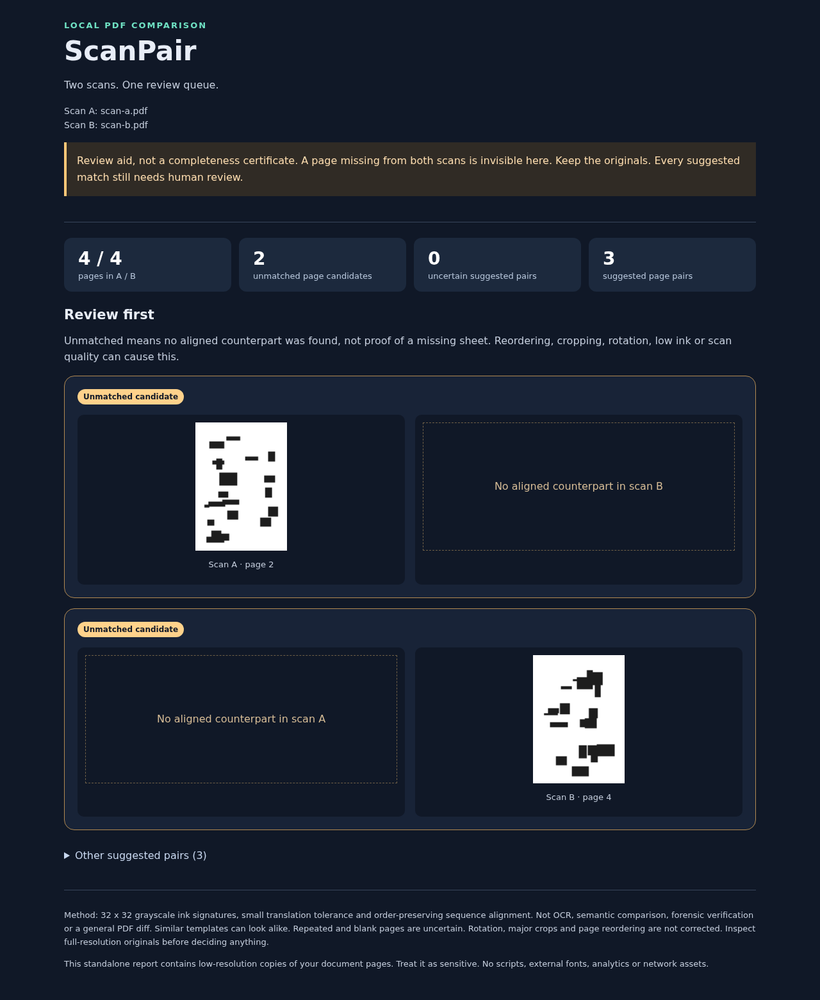

# ScanPair

**Two scans. One review queue.**

A small C++17 command-line tool that compares **two local PDFs of the same paper bundle** and writes an offline HTML report with candidate unmatched pages and side-by-side previews.

Example: a feeder occasionally takes two sheets at once. Scan the bundle twice, then review pages without aligned counterparts instead of comparing every page manually.

> **Not a completeness certificate.** A page missing from both scans cannot be detected. Similar pages can be paired incorrectly. Every result needs human review. Keep the paper and full-resolution originals.



## What it does

- Renders PDFs locally with Poppler's `pdftoppm`.
- Compares small grayscale ink signatures with limited translation tolerance.
- Uses order-preserving sequence alignment to suggest page counterparts.
- Puts unmatched candidates, low-similarity pairs, blank/low-ink pages and competing matches in a priority review queue.
- Includes every other suggested pair in an expandable section.
- Writes one self-contained HTML report, with embedded low-resolution previews. No server, accounts, uploads, paid API, OCR, browser script or network assets.
- Leaves source PDFs unchanged and refuses to overwrite an existing report or output symlink.

This is an original, deliberately limited portfolio implementation, **not a claim of a novel algorithm or an unmet market**. See alternatives below.

## Build

Supported target: Linux or macOS with POSIX process APIs. Windows users can use WSL. Tested on Linux with GCC 11, CMake 3.22 and Poppler 22.02; macOS has not been tested here.

Runtime dependency: Poppler's `pdftoppm` available on `PATH`. Build dependencies: C++17 compiler and CMake 3.16+.

Ubuntu / Debian:

```sh
sudo apt install build-essential cmake poppler-utils python3
```

macOS with Homebrew:

```sh
brew install cmake poppler
```

From a source checkout:

```sh
cmake -S . -B build -DCMAKE_BUILD_TYPE=Release
cmake --build build
ctest --test-dir build --output-on-failure
```

Python 3 is only needed for the integration tests and fictional demo generator, not for the application. CMake skips the integration test if Python or `pdftoppm` is unavailable; install both to run the full suite.

## Use

```sh
./build/scanpair "first scan.pdf" "second scan.pdf" "review.html"
```

Open `review.html` in your normal browser. It works offline. The output filename must be new and end in `.html`; its parent directory must already exist.

- **Unmatched candidate:** no counterpart was found in the order-preserving alignment. It may be a missing page, a reordered page, a different crop or a failed visual match.
- **Uncertain pair:** low ink, similarity below 90/100, or another visually competitive counterpart. Review these carefully.
- **Suggested pair:** the heuristic found a stronger pairing, not a verified match. These still need review.
- **Visual similarity:** an ink-overlap score, not a probability or measured accuracy. It does not mean the page contents are identical.

Inputs are referred to as scan A and scan B. Page numbers are **1-based PDF positions**, not printed page numbers. Exit codes: `0` report written or help shown, `1` processing error, `2` incorrect arguments. Unmatched candidates do not cause a nonzero exit code.

```sh
./build/scanpair --help
```

## Try it without private documents

Generate fictional PDFs made of geometric shapes:

```sh
python3 integration_test.py --demo demo
./build/scanpair demo/scan-a.pdf demo/scan-b.pdf demo/review.html
```

Expected: scan A page 2 and scan B page 4 have no counterpart, with three suggested pairs. `11-preview.png` shows this generated example, not user documents.

## Method and limits

Poppler renders the first 1001 pages at a maximum dimension of 128 pixels. If either input has more than 1000 pages, the run fails rather than silently truncating it. Each page becomes a 32 x 32 grayscale ink grid. Matching uses soft ink intersection-over-union over nine small translations, then dynamic programming with insertion/deletion costs. Candidate pairs below a fixed 0.78 similarity are not aligned. Near-tie counterparts within 0.03 are flagged. These thresholds are heuristics, **not validated accuracy guarantees**.

- Both scans should be of the same bundle, in the same order and orientation.
- No OCR, text extraction, semantic understanding, automatic deskew, rotation correction, crop correction, page merging or document deletion.
- Repeated forms, similar text layouts, blank pages and tiny edits are difficult. A small changed field may disappear at preview resolution. This is not a content-diff or forgery detector.
- Significant skew, lighting changes, crops or reordered sheets may produce extra unmatched candidates or wrong pairs. A one-cell translation is only a small alignment tolerance, not general scanner registration.
- It cannot discover pages absent from both PDFs, establish the original page count, or prove completeness. Never destroy originals based on the report.
- O(A x B) alignment and pair comparisons, with 1000 pages per input maximum. Reports can be tens of MB because previews are embedded. The 600-page motivation is a use case, not a tested accuracy or throughput claim.
- A renderer run is stopped after 180 seconds per PDF. Password-protected, damaged or complex PDFs may fail. No password collection or unlocking workflow is provided.

## Privacy and safety

The application does not make network requests. Rendering uses a subprocess with separate arguments, not a shell command. Reports contain document-page images and input **filenames** (not full input paths), so treat reports as sensitive too. Reports are created with owner-only permissions on supported systems; deliberately sharing one discloses its contents.

Temporary rendered pages are stored in a private system temporary directory and removed on normal completion or handled errors. A forced termination, power loss or operating-system crash can leave a `scanpair-*` temporary directory behind. Remove it yourself when safe. Failed/partial report writes are removed on handled write errors; an abrupt kill during the final write can leave an incomplete report.

Keep Poppler and your OS updated. PDFs can be hostile; ScanPair is not a malware sandbox. Run unfamiliar documents with the same caution as any other PDF processor. The application only renders and reports; it does not rewrite the source PDFs.

## Tests

```sh
./build/scanpair_tests
python3 integration_test.py ./build/scanpair
```

The suite has 25 C++ checks and 18 end-to-end PDF checks. It covers sequence insertions/deletions, small translations, blank/repeated pages, unrelated pages, PGM parsing errors, safe HTML escaping, actual PDF rendering, correct demo positions, unchanged source hashes, output overwrite/symlink protection, spaces and shell metacharacters in paths, malformed PDFs and a missing renderer.

These are regression checks on synthetic examples, **not a real-world scan accuracy benchmark**. There is no bundled production dataset. The report was visually checked at desktop and 390px mobile widths.

## Motivation and alternatives

A concrete two-scan workflow was described in [this Reddit request](https://www.reddit.com/r/pdf/comments/1lubayt/anyway_to_compare_2_pdf_and_missing_which_page/). It is one example, not evidence of broad demand.

Existing software already addresses related workflows:

- [Kogo](https://github.com/ta-061/kogo): visual-signature page alignment and scanner-shift registration, including image-only PDFs.
- [pdfcmp](https://github.com/asaf-shitrit/pdfcmp): page alignment and rescan-aware visual comparison.
- [PDF-Diff-Viewer](https://github.com/ssibb/PDF-Diff-Viewer): another comparison tool suggested in the discussion; its README notes that image-only scans need OCR first.

ScanPair does not use their code or claim to outperform them. Choose a more capable existing tool if its behavior fits your documents.

## License

MIT. See [LICENSE](LICENSE). Poppler is an external dependency with its own license; it is not bundled here.
